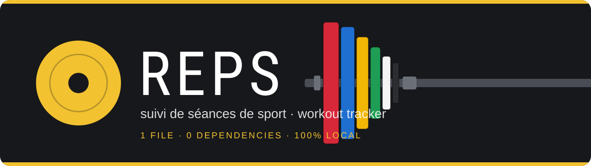
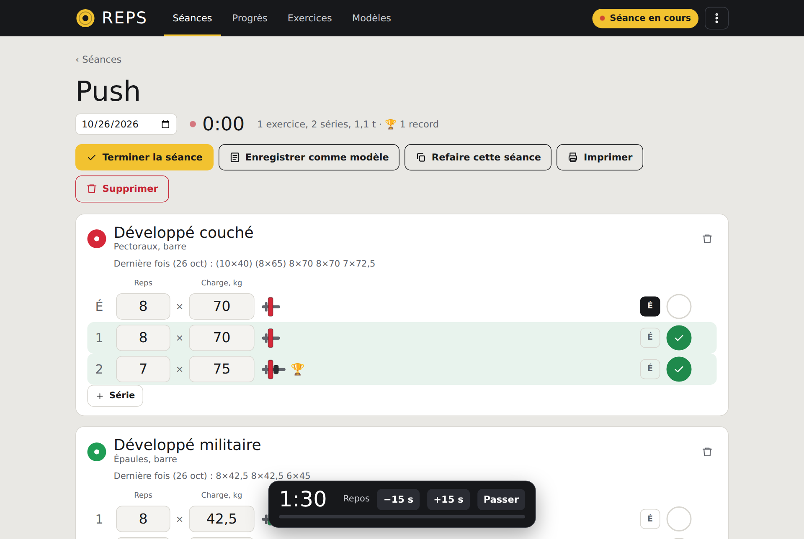
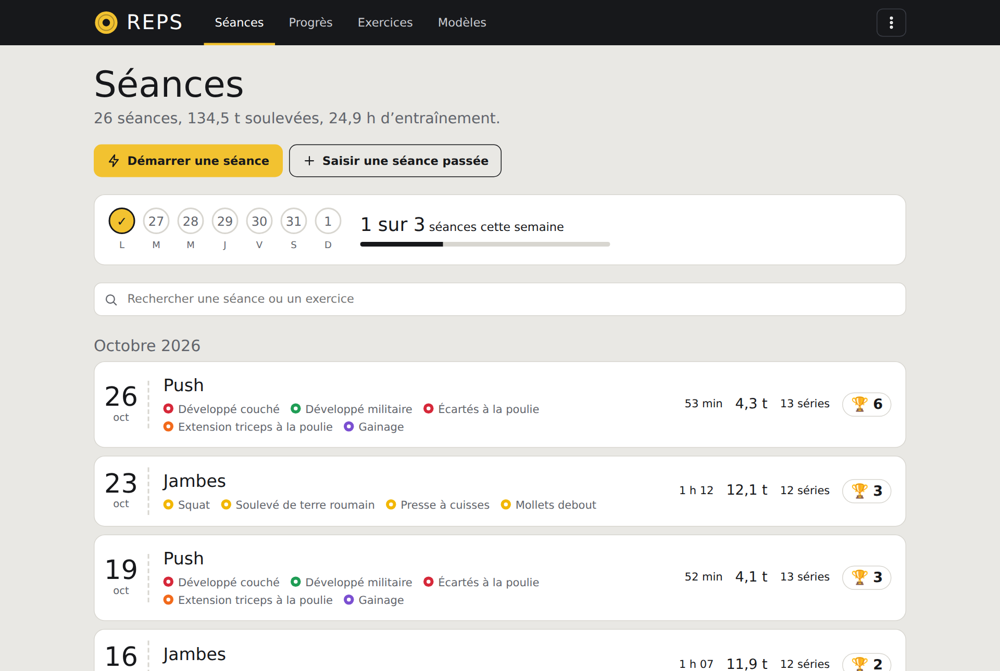
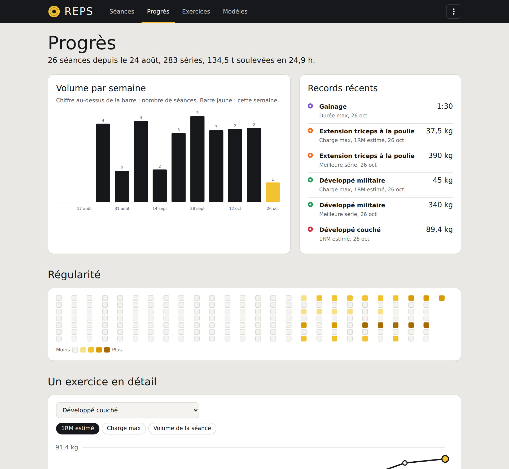
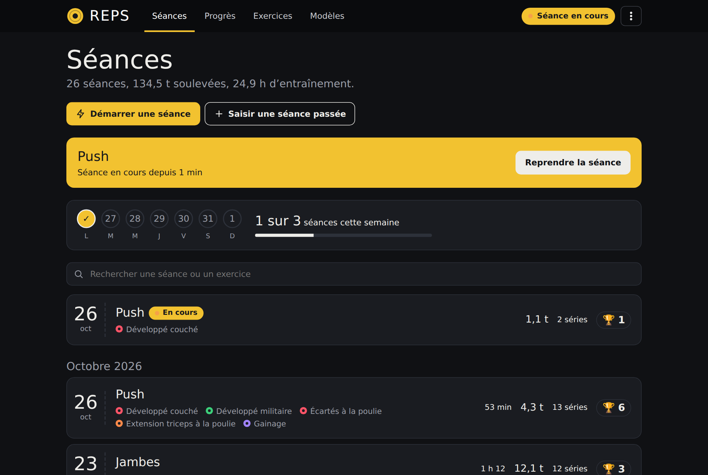
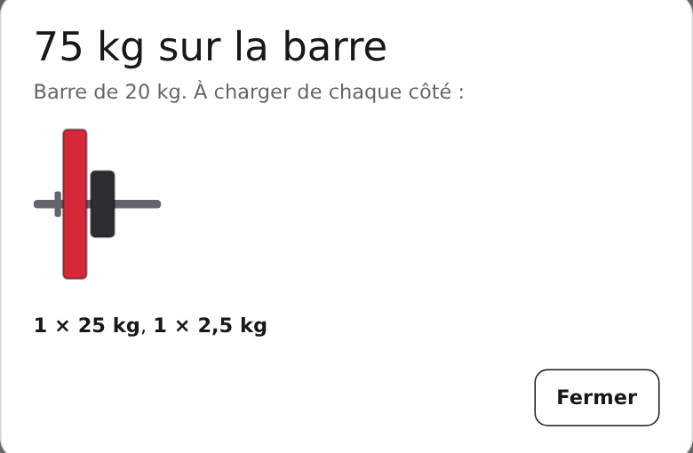
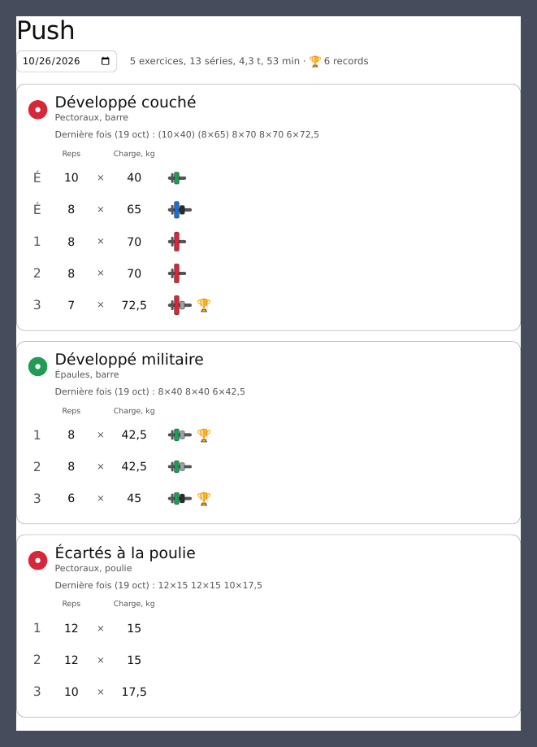
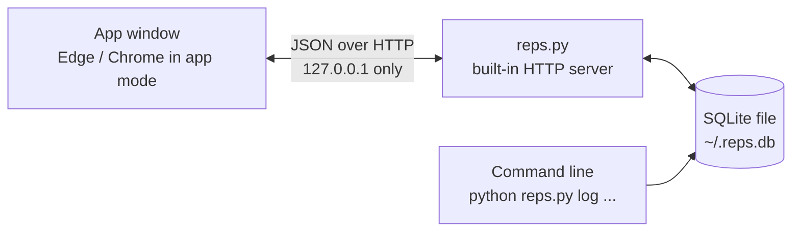
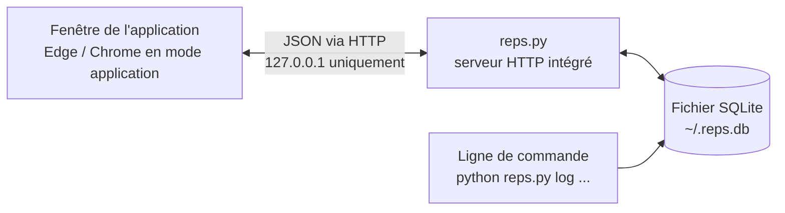

<a id="top"></a>

<div align="center">



<br>

**Log every set. Beat your last session. Keep it all on your computer.**<br>
*Notez chaque série, battez votre dernière séance, gardez tout chez vous.*

<br>

No account · No cloud · No subscription · No dependencies<br>
*Pas de compte · Pas de cloud · Pas d'abonnement · Aucune dépendance*

<br>

[](https://www.python.org/downloads/)
[](#local-en)
[](#local-en)
[](#under-the-hood-en)
[](#install-en)
[](#status-en)

### [English](#english)  ·  [Français](#francais)

<br>



</div>

<br>

<a id="english"></a>

# English

<div align="center">

[Features](#features-en) · [How it works](#how-it-works-en) · [Install](#install-en) · [Exports](#exports-en) · [Local & private](#local-en) · [Command line](#cli-en) · [FAQ](#faq-en)

</div>

<br>

<a id="features-en"></a>

## 💪 Features

|   |   |
|---|---|
| 🏋️ **Live workouts** | Start a session and log sets as you train: reps × weight, one tick per set. A clock runs, and a rest countdown starts after every working set (90 s by default, ±15 s, with a beep). |
| 🔁 **Beat your last session** | Under each exercise you see what you did last time. Fields come pre-filled with it, and the previous numbers show as ghost hints. |
| 🏆 **Personal records** | Heaviest weight, estimated 1RM, best set, most reps, longest hold, longest distance, fastest pace — spotted the moment you tick a set that beats your history. |
| 🧮 **Plate calculator** | On barbell lifts, tiny colour-coded plates show what to load on each side. Click for the full picture. |
| 📋 **Templates** | Turn any session into a template. Start it later with your last weights already in place. |
| 📈 **Progress** | Weekly volume, a 26-week consistency heatmap, a weekly goal with streak, one curve per exercise, muscle-group split, body weight. |
| 🗂️ **29 exercises ready** | Colour-coded by muscle group like barbell plates. Strength, bodyweight, timed and cardio exercises each get the right fields. Add your own. |
| 📤 **Exports** | CSV for your spreadsheet, Markdown, JSON, a one-click backup, and a printable session. |
| ⌨️ **Command line too** | `python reps.py log "Squat" 5x100 5x100 5x100` — logged in ten seconds. |
| 🔒 **Private by design** | Everything lives in one file on your disk. The app never talks to the internet. |

<br>

<a id="how-it-works-en"></a>

## 🧭 How it works

> The interface is currently in **French**. Button names are given below in *italics* with their English meaning.

**1 · Start.** Click **Start a workout** (*Démarrer une séance*). Name it, or pick a template. The clock starts, and every exercise comes pre-filled with what you lifted last time.

**2 · Log as you go.** Adjust reps and weight if needed, then tick the circle at the end of the row. The row turns green and the rest timer starts. <kbd>Enter</kbd> jumps to the next field. Press **É** on a row to mark it as a warm-up: it never counts towards volume or records. **+ Série** adds a set (copied from the previous one), **Add an exercise** (*Ajouter un exercice*) opens a search; type a new name to create the exercise on the spot.

**3 · Finish.** Click **Finish the workout** (*Terminer la séance*). Sets you never ticked are dropped, and Reps shows your summary and every record you broke. A session without a single logged set is simply discarded.

**4 · Look back.** The home page shows this week at a glance (*"1 of 3 workouts this week"*), then all your sessions by month, with a 🏆 on the ones that set records. Search by session or exercise name — accents don't matter.

**5 · Already trained?** **Log a past workout** (*Saisir une séance passée*) lets you enter a session after the fact. Sets count immediately, no ticking needed.

<details>
<summary><b>Keyboard</b></summary>

<br>

| Keys | Action |
|---|---|
| <kbd>Enter</kbd> in a field | Save it and move to the next one |
| <kbd>Esc</kbd> | Close a dialog or the menu |

</details>

<br>

<table>
<tr>
<td width="50%"><br><sub><b>Home</b> — your week, your goal, your sessions.</sub></td>
<td width="50%"><br><sub><b>Progress</b> — volume, records, consistency, one curve per exercise.</sub></td>
</tr>
<tr>
<td width="50%"><br><sub><b>Dark theme</b> — automatic, or your choice.</sub></td>
<td width="50%"><br><sub><b>Plate calculator</b> — what to load on each side of the bar.</sub></td>
</tr>
</table>

<br>

<a id="install-en"></a>

## 🚀 Install

Reps is a **single Python file**. There is nothing to install except Python itself.

### Requirements

- **Python 3** (from [python.org](https://www.python.org/downloads/) — on Windows, tick **"Add Python to PATH"**).
- **Microsoft Edge, Google Chrome, Chromium or Brave** for the clean app-window look. Edge is already on Windows 10/11. Without one of them, Reps falls back to your default browser.
- No `pip install`, no virtual environment, no internet connection.

### Windows — double-click

1. Put `reps.py` and `lancer.bat` in the same folder.
2. Double-click **`lancer.bat`**.
3. Press **`1`** for the app window, or **`2`** to use your browser.

### Any system — one command

```bash
python reps.py          # opens the app window (default)
python reps.py web      # same interface, in your browser (--port 8001, --no-browser)
```

> On macOS and Linux, use `python3` if `python` isn't available.

### Make a standalone `Reps.exe` (Windows)

1. Keep `reps.py` and `build_exe.bat` in the same folder.
2. Double-click **`build_exe.bat`**. It installs [PyInstaller](https://pyinstaller.org/) and builds the app (1–2 minutes).
3. Grab **`dist\Reps.exe`** and copy it anywhere. Drop a `reps.ico` next to the script before building to give it an icon.

```bat
py -m PyInstaller --onefile --windowed --clean --noconfirm --name Reps --exclude-module tkinter reps.py
```

<sub>The executable is not code-signed, so Windows SmartScreen or your antivirus may warn on first launch — see the [FAQ](#faq-en).</sub>

<br>

<a id="exports-en"></a>

## 📤 Exports

Your training log is never locked in. Open the **⋮** menu in the top-right corner:

| Format | What you get |
|---|---|
| **CSV** `.csv` | One row per set, ready for Excel, LibreOffice or Google Sheets (semicolon-separated, UTF-8 with BOM so accents survive, decimal comma). |
| **Markdown** `.md` | A readable training diary, newest session first. Warm-ups are shown in brackets. |
| **JSON** `.json` | Structured data: sessions, exercises, sets, and your body-weight entries. |
| **Backup** `.db` | A complete, consistent copy of the whole database — also from the command line with `python reps.py sauvegarde`. |
| **Print** | **Print** (*Imprimer*) on a session gives a clean, light-theme page, ready for paper or PDF. |

<div align="center">

<br><sub><b>Print</b> — one clean page per session, always in the light theme.</sub>

</div>

<details>
<summary><b>What the files look like</b></summary>

<br>

**CSV**

```text
jour;seance;exercice;groupe;numero_serie;echauffement;repetitions;poids_kg;duree_s;distance_m
2026-10-26;Push;Développé couché;Pectoraux;1;1;10;40;;
2026-10-26;Push;Développé couché;Pectoraux;2;0;8;70;;
2026-10-26;Push;Gainage;Tronc;1;0;;;90;
```

**Markdown**

```markdown
# Journal d'entraînement

## 2026-10-26 — Push (58 min, 2210 kg soulevés)

- **Développé couché** : (10×40), 8×70, 8×70, 7×72,5
- **Gainage** : 90 s
```

**JSON**

```json
{
  "seances": [
    {
      "jour": "2026-10-26",
      "nom": "Push",
      "duree_min": 58,
      "note": null,
      "volume": 2210.0,
      "exercices": [
        {
          "exercice": "Développé couché",
          "groupe": "pecs",
          "type": "charge",
          "series": [{ "reps": 8, "poids": 70.0, "duree_s": null, "distance_m": null, "echauffement": false }]
        }
      ]
    }
  ],
  "mesures": [{ "jour": "2026-10-25", "poids": 79.1 }]
}
```

</details>

<br>

<a id="local-en"></a>

## 🏠 Everything runs locally

Reps has no server "out there". When you launch it, it starts a tiny web server **inside your own computer** that only your computer can reach, and opens a window onto it.



| | |
|---|---|
| **Where is my data?** | One SQLite file: `~/.reps.db` — on Windows `C:\Users\<you>\.reps.db`. Sessions, sets, exercises, templates, body weight and settings all live in it. |
| **Does it use the internet?** | No. The page loads no font, script, image or analytics from anywhere. It only talks to `127.0.0.1`. |
| **Who can reach the server?** | Only your machine: it listens on `127.0.0.1`, never on your network. |
| **How do I back it up?** | **⋮ → Sauvegarder mes données** (or `python reps.py sauvegarde`): one `.db` file with everything. |
| **How do I restore a backup?** | Close Reps, then replace `~/.reps.db` with your backup file (same name). Keep the old file until you've checked. |
| **Does it keep running in the background?** | No. Closing the window stops the app a few seconds later (a quick reload doesn't). **⋮ → Quitter** does it immediately. |
| **Which port?** | `8766` for the app window (a free one is picked if it's busy), `8001` for `web`. Launching Reps twice just opens a second window on the running instance. |

<details>
<summary><b>Security measures</b></summary>

<br>

The server is local-only, but it still defends itself, because any website you visit could try to poke at `localhost`:

- Listens on **`127.0.0.1` only**.
- Rejects requests whose **`Host`** header isn't `127.0.0.1:<port>` or `localhost:<port>` (protects against DNS rebinding).
- Rejects requests whose **`Origin`** differs from the page's own.
- `POST` / `PUT` bodies must be **`application/json`**, which a foreign website cannot send without a permission check the server never grants.
- Everything you type is **HTML-escaped** before display; pages and API responses carry `X-Content-Type-Options: nosniff` and `Cache-Control: no-store`.

</details>

<br>

<a id="under-the-hood-en"></a>

## ⚡ Under the hood

Built to stay fast with years of training, using only Python's standard library.

- **SQLite in WAL mode** (`synchronous=NORMAL`), indexes on `serie(seance_id, ordre)` and `serie(exercice_id)`.
- **Records in one pass**: the whole history is scanned once, and the result is cached until the next write.
- **Accent-insensitive search** through a custom SQLite function, so `developpe` finds *Développé*.
- **Statistics in a handful of queries**: weekly volume, consistency, streak, muscle-group split.
- **Consistent backups** with SQLite's own backup API, even while the app is running.
- **Threaded server + one lock** around the database, so a slow request never blocks the window.
- **Zero build step**: the interface is a single HTML/CSS/JS page embedded in `reps.py`. No framework, no bundler.

<details>
<summary><b>How records work</b></summary>

<br>

A record is flagged on a set you have **ticked**, when the **best value of that session** beats the best value of **all earlier sessions**. The first time you do an exercise is never a record, and warm-ups never count.

| Exercise type | Records tracked |
|---|---|
| **Weighted** (reps × kg) | Heaviest weight, **estimated 1RM** (Epley: `weight × (1 + reps / 30)`, up to 12 reps), best set (reps × weight) |
| **Bodyweight** | Most reps in a set, heaviest added weight |
| **Timed** | Longest duration |
| **Cardio** | Longest distance, fastest pace (from 1 km) |

</details>

<details>
<summary><b>Data model</b></summary>

<br>

| Table | Purpose |
|---|---|
| `exercice` | `nom` (unique), `groupe`, `type` (`charge`, `corps`, `duree`, `cardio`), `equipement`, `archive` |
| `seance` | `nom`, `jour`, `duree_min`, `note`, `en_cours`, `debut_ts` |
| `serie` | one set: `seance_id` (cascade), `exercice_id`, `ordre`, `reps`, `poids`, `duree_s`, `distance_m`, `echauffement`, `fait` |
| `modele` / `modele_exo` | templates and their exercises (sets, target reps and weight) |
| `mesure` | body weight, one entry per day |
| `reglage` | settings: theme, default rest, bar weight, weekly goal |

An exercise that has been used is **archived**, never deleted, so your history stays intact.

</details>

<details>
<summary><b>Local HTTP API</b></summary>

<br>

The window talks to the server through a small JSON API (handy for scripting while Reps is running).

| Method | Path | Purpose |
|---|---|---|
| `GET` | `/api/seances?q=&limite=&decalage=` | List sessions (search, paging) |
| `POST` | `/api/seance` | Start or create a session (`en_cours`, `modele_id`, `copie_id`, `jour`, `nom`) |
| `GET` `PUT` `DELETE` | `/api/seance/<id>` | Read (with records and last performance), edit, delete |
| `POST` | `/api/seance/<id>/terminer` | Finish a live session |
| `POST` | `/api/seance/<id>/exercice` | Add an exercise (pre-filled from last time) |
| `DELETE` | `/api/seance/<id>/exercice/<exercice_id>` | Remove an exercise from a session |
| `POST` | `/api/seance/<id>/modele` | Save the session as a template |
| `POST` | `/api/serie` | Add a set |
| `PUT` `DELETE` | `/api/serie/<id>` | Edit (partial) or delete a set |
| `GET` `POST` | `/api/exercices`, `/api/exercice` | List (`?archives=1`) or create exercises |
| `PUT` `DELETE` | `/api/exercice/<id>` | Edit, archive or delete an exercise |
| `GET` | `/api/modeles` | List templates |
| `PUT` `DELETE` | `/api/modele/<id>` | Rename or delete a template |
| `GET` | `/api/stats` | Totals, weekly volume, heatmap, streak, recent records |
| `GET` | `/api/progres/<exercice_id>` | Per-session curve and records for one exercise |
| `POST` `DELETE` | `/api/mesure`, `/api/mesure/<id>` | Body-weight entries |
| `GET` `PUT` | `/api/reglages`, `/api/reglage` | Read / write settings |
| `GET` | `/api/export?format=csv\|md\|json` | Download an export |
| `GET` | `/api/sauvegarde` | Download a consistent copy of the database |
| `GET` `POST` | `/api/ping`, `/api/bye`, `/api/quit` | Window heartbeat, window closed, quit |

</details>

<br>

<a id="cli-en"></a>

## ⌨️ Command line

The terminal commands share the same database as the app. Their messages are in French.

```bash
python reps.py log "Développé couché" 8x60 8x60 6x62,5 --seance "Push A"
python reps.py log squat 5x100 5x100 5x105 --jour 2026-10-20 --duree 70
python reps.py log "course à pied" 5km:25min
python reps.py historique
python reps.py records "développé couché"
python reps.py stats
python reps.py export --format csv -o entrainements.csv
python reps.py sauvegarde -o mon-reps.db
```

Exercise names are matched loosely: case, accents and partial names are fine (`"course"` finds *Course à pied*), as long as the match is unique.

<details>
<summary><b>All commands and set formats</b></summary>

<br>

| Command | Purpose | Options |
|---|---|---|
| *(none)* / `gui` | Open the app window | |
| `web` | Open the interface in your browser | `--port`, `--no-browser` |
| `log <exercise> <sets…>` | Log sets into a session of the day | `--jour YYYY-MM-DD`, `--seance <name>`, `--duree <minutes>` |
| `historique` | List sessions | `--limite`, `--recherche` |
| `records [exercise]` | Personal records | |
| `stats` | Training summary | |
| `export` | Export data | `--format csv\|json\|md`, `-o file` |
| `sauvegarde` | Save a full copy of the database | `-o file.db` |

| Set format | Meaning |
|---|---|
| `8x60`, `8×62,5` | 8 reps at 60 kg / 62.5 kg |
| `12` | 12 reps (bodyweight), or 12 seconds on a timed exercise |
| `45s`, `1m30`, `1h05` | A duration |
| `5km`, `5km:25min`, `5km:23min30` | Distance, with an optional time |

</details>

<br>

<a id="faq-en"></a>

## 🧰 FAQ

<details>
<summary><b>"python is not recognized as a command" (Windows)</b></summary>

<br>

Install Python from [python.org](https://www.python.org/downloads/) and tick **"Add Python to PATH"**. `lancer.bat` also tries the `py` launcher automatically.

</details>

<details>
<summary><b>The app opens in my normal browser instead of its own window</b></summary>

<br>

Reps looks for Edge, Chrome, Chromium or Brave to open a chrome-less window. If none is found it uses your default browser — everything works, you just see a tab. Use **⋮ → Quitter** to stop it.

</details>

<details>
<summary><b>Windows or my antivirus warns about <code>Reps.exe</code></b></summary>

<br>

The executable isn't code-signed, and single-file PyInstaller programs are often flagged by cautious scanners. Click **More info → Run anyway**, or skip the `.exe` and run `python reps.py` — it's one readable file you can inspect yourself.

</details>

<details>
<summary><b>I ticked a set by mistake</b></summary>

<br>

Tick it again to untick it. Records and totals update right away. A set you never ticked is removed when you finish the workout.

</details>

<details>
<summary><b>Is the estimated 1RM accurate?</b></summary>

<br>

It's an estimate (Epley formula), best below about 8 reps and unavailable above 12. Use it to compare sessions with each other, not as a promise of what you can lift on a max attempt.

</details>

<details>
<summary><b>Can I use Reps on two computers?</b></summary>

<br>

There's no sync. You can copy `~/.reps.db` from one machine to another while Reps is closed. Avoid keeping the live file in a cloud-synced folder, and never open the same file on two machines at once — SQLite databases don't like that.

</details>

<br>

<a id="status-en"></a>

## 📌 Status & limits

- **Interface language: French only** for now (CLI messages too). An English interface is a natural next step.
- **Kilograms only.** There is no pound mode yet.
- One live workout at a time, single user, single computer, no sync.
- Built and tested with **Python 3.12** and a Chromium engine. Windows 10/11 with Edge is the primary target; macOS and Linux should work through the same Chromium-based window or `web` mode.
- Ideas, not promises: English interface, kg/lb switch, supersets, import from CSV, one-click restore.

<br>

## 🗂️ What's in the box

```text
reps/
├── reps.py              the entire app: storage + CLI + local server + interface
├── lancer.bat           Windows launcher (window or browser)
├── build_exe.bat        builds dist\Reps.exe with PyInstaller
├── README.md            you are here (English + Français)
├── assets/banner.svg
└── docs/screenshots/
```

<p align="right"><a href="#top">↑ Top</a> · <a href="#francais">Passer en français →</a></p>

---

<a id="francais"></a>

# Français

<div align="center">

[Fonctionnalités](#features-fr) · [Fonctionnement](#how-it-works-fr) · [Installation](#install-fr) · [Exports](#exports-fr) · [Local et privé](#local-fr) · [Ligne de commande](#cli-fr) · [FAQ](#faq-fr)

</div>

<br>

<a id="features-fr"></a>

## 💪 Fonctionnalités

|   |   |
|---|---|
| 🏋️ **Séances en direct** | Démarrer une séance et noter les séries au fil de l'entraînement : répétitions × charge, un clic par série. Un chrono tourne, et un minuteur de repos se lance après chaque série de travail (90 s par défaut, ±15 s, avec un bip). |
| 🔁 **Battre sa dernière séance** | Sous chaque exercice, ce qui a été fait la dernière fois. Les champs sont préremplis avec ces valeurs, et les chiffres précédents apparaissent en filigrane. |
| 🏆 **Records personnels** | Charge max, 1RM estimé, meilleure série, répétitions max, gainage le plus long, distance max, meilleure allure : repérés dès qu'une série cochée bat l'historique. |
| 🧮 **Calculateur de disques** | Sur les mouvements à la barre, de petits disques colorés montrent ce qu'il faut charger de chaque côté. Un clic ouvre la vue complète. |
| 📋 **Modèles** | Toute séance peut devenir un modèle. On le relance plus tard avec les dernières charges déjà en place. |
| 📈 **Progrès** | Volume par semaine, frise de régularité sur 26 semaines, objectif hebdomadaire avec série, une courbe par exercice, répartition par groupe musculaire, poids du corps. |
| 🗂️ **29 exercices prêts** | Colorés par groupe musculaire comme des disques de barre. Force, poids du corps, durée et cardio ont chacun les bons champs. On ajoute les siens. |
| 📤 **Exports** | CSV pour le tableur, Markdown, JSON, sauvegarde en un clic, séance imprimable. |
| ⌨️ **Aussi en ligne de commande** | `python reps.py log "Squat" 5x100 5x100 5x100` : noté en dix secondes. |
| 🔒 **Privé par conception** | Tout vit dans un seul fichier sur le disque. L'application ne communique jamais avec Internet. |

<br>

<a id="how-it-works-fr"></a>

## 🧭 Fonctionnement

**1 · Démarrer.** Cliquer sur **Démarrer une séance**. La nommer, ou choisir un modèle. Le chrono démarre et chaque exercice est prérempli avec ce qui a été soulevé la dernière fois.

**2 · Noter au fil de la séance.** Ajuster les répétitions et la charge si besoin, puis cocher le cercle en bout de ligne. La ligne devient verte et le minuteur de repos démarre. <kbd>Entrée</kbd> passe au champ suivant. Le bouton **É** d'une ligne la marque comme échauffement : elle ne compte ni dans le volume ni dans les records. **+ Série** ajoute une série (copie de la précédente) ; **Ajouter un exercice** ouvre une recherche, et taper un nouveau nom crée l'exercice sur-le-champ.

**3 · Terminer.** Cliquer sur **Terminer la séance**. Les séries jamais cochées sont retirées, et Reps affiche le résumé et tous les records battus. Une séance sans aucune série notée est simplement abandonnée.

**4 · Revenir en arrière.** L'accueil montre la semaine d'un coup d'œil (*« 1 sur 3 séances cette semaine »*), puis toutes les séances par mois, avec un 🏆 sur celles qui ont battu des records. La recherche porte sur le nom de la séance ou d'un exercice, sans se soucier des accents.

**5 · Déjà fait l'entraînement ?** **Saisir une séance passée** permet d'entrer une séance après coup. Les séries comptent tout de suite, sans cocher.

<details>
<summary><b>Clavier</b></summary>

<br>

| Touches | Action |
|---|---|
| <kbd>Entrée</kbd> dans un champ | L'enregistrer et passer au suivant |
| <kbd>Échap</kbd> | Fermer une fenêtre ou le menu |

</details>

<br>

<table>
<tr>
<td width="50%"><br><sub><b>Accueil</b> : la semaine, l'objectif, les séances.</sub></td>
<td width="50%"><br><sub><b>Progrès</b> : volume, records, régularité, une courbe par exercice.</sub></td>
</tr>
<tr>
<td width="50%"><br><sub><b>Thème sombre</b> : automatique, ou selon votre choix.</sub></td>
<td width="50%"><br><sub><b>Calculateur de disques</b> : quoi charger de chaque côté de la barre.</sub></td>
</tr>
</table>

<br>

<a id="install-fr"></a>

## 🚀 Installation

Reps tient dans **un seul fichier Python**. Il n'y a rien à installer, à part Python lui-même.

### Prérequis

- **Python 3** (sur [python.org](https://www.python.org/downloads/) ; sous Windows, cocher **« Add Python to PATH »**).
- **Microsoft Edge, Google Chrome, Chromium ou Brave** pour la fenêtre d'application épurée. Edge est déjà présent sur Windows 10/11. À défaut, Reps s'ouvre dans le navigateur par défaut.
- Pas de `pip install`, pas d'environnement virtuel, pas de connexion Internet.

### Windows : un double-clic

1. Placer `reps.py` et `lancer.bat` dans le même dossier.
2. Double-cliquer sur **`lancer.bat`**.
3. Taper **`1`** pour la fenêtre d'application, ou **`2`** pour utiliser le navigateur.

### Tous systèmes : une commande

```bash
python reps.py          # ouvre la fenêtre d'application (par défaut)
python reps.py web      # même interface, dans le navigateur (--port 8001, --no-browser)
```

> Sous macOS et Linux, utiliser `python3` si `python` n'existe pas.

### Créer un `Reps.exe` autonome (Windows)

1. Garder `reps.py` et `build_exe.bat` dans le même dossier.
2. Double-cliquer sur **`build_exe.bat`**. Il installe [PyInstaller](https://pyinstaller.org/) puis construit l'application (1 à 2 minutes).
3. Récupérer **`dist\Reps.exe`**, qui peut être copié n'importe où. Un fichier `reps.ico` placé à côté du script avant la construction sert d'icône.

```bat
py -m PyInstaller --onefile --windowed --clean --noconfirm --name Reps --exclude-module tkinter reps.py
```

<sub>L'exécutable n'est pas signé : Windows SmartScreen ou l'antivirus peuvent afficher un avertissement au premier lancement (voir la [FAQ](#faq-fr)).</sub>

<br>

<a id="exports-fr"></a>

## 📤 Exports

Le journal d'entraînement n'est jamais enfermé. Le menu **⋮**, en haut à droite, propose :

| Format | Contenu |
|---|---|
| **CSV** `.csv` | Une ligne par série, prête pour Excel, LibreOffice ou Google Sheets (séparateur point-virgule, UTF-8 avec BOM pour conserver les accents, virgule décimale). |
| **Markdown** `.md` | Un carnet d'entraînement lisible, séance la plus récente en premier. Les échauffements sont entre parenthèses. |
| **JSON** `.json` | Données structurées : séances, exercices, séries, et pesées du corps. |
| **Sauvegarde** `.db` | Une copie complète et cohérente de toute la base, aussi en ligne de commande avec `python reps.py sauvegarde`. |
| **Impression** | **Imprimer** sur une séance donne une page claire et soignée, prête pour le papier ou le PDF. |

<div align="center">

<br><sub><b>Impression</b> : une page nette par séance, toujours en thème clair.</sub>

</div>

<details>
<summary><b>À quoi ressemblent les fichiers</b></summary>

<br>

**CSV**

```text
jour;seance;exercice;groupe;numero_serie;echauffement;repetitions;poids_kg;duree_s;distance_m
2026-10-26;Push;Développé couché;Pectoraux;1;1;10;40;;
2026-10-26;Push;Développé couché;Pectoraux;2;0;8;70;;
2026-10-26;Push;Gainage;Tronc;1;0;;;90;
```

**Markdown**

```markdown
# Journal d'entraînement

## 2026-10-26 — Push (58 min, 2210 kg soulevés)

- **Développé couché** : (10×40), 8×70, 8×70, 7×72,5
- **Gainage** : 90 s
```

**JSON**

```json
{
  "seances": [
    {
      "jour": "2026-10-26",
      "nom": "Push",
      "duree_min": 58,
      "note": null,
      "volume": 2210.0,
      "exercices": [
        {
          "exercice": "Développé couché",
          "groupe": "pecs",
          "type": "charge",
          "series": [{ "reps": 8, "poids": 70.0, "duree_s": null, "distance_m": null, "echauffement": false }]
        }
      ]
    }
  ],
  "mesures": [{ "jour": "2026-10-25", "poids": 79.1 }]
}
```

</details>

<br>

<a id="local-fr"></a>

## 🏠 Tout tourne en local

Reps n'a aucun serveur « quelque part sur Internet ». Au lancement, il démarre un minuscule serveur web **à l'intérieur de votre propre ordinateur**, joignable uniquement depuis celui-ci, et ouvre une fenêtre dessus.



| | |
|---|---|
| **Où sont mes données ?** | Dans un seul fichier SQLite : `~/.reps.db`, soit sous Windows `C:\Users\<vous>\.reps.db`. Séances, séries, exercices, modèles, poids du corps et réglages y sont tous stockés. |
| **Internet est-il utilisé ?** | Non. La page ne charge aucune police, aucun script, aucune image ni aucun outil de statistiques depuis l'extérieur. Elle ne parle qu'à `127.0.0.1`. |
| **Qui peut joindre le serveur ?** | Uniquement votre machine : il écoute sur `127.0.0.1` et jamais sur le réseau. |
| **Comment sauvegarder ?** | **⋮ → Sauvegarder mes données** (ou `python reps.py sauvegarde`) : un seul fichier `.db` contient tout. |
| **Comment restaurer une sauvegarde ?** | Fermer Reps, puis remplacer `~/.reps.db` par le fichier de sauvegarde (même nom). Garder l'ancien fichier de côté le temps de vérifier. |
| **Reste-t-il actif en arrière-plan ?** | Non. Fermer la fenêtre arrête l'application quelques secondes plus tard (un simple rechargement ne l'arrête pas). **⋮ → Quitter** le fait immédiatement. |
| **Quel port ?** | `8766` pour la fenêtre d'application (un port libre est choisi s'il est occupé), `8001` pour `web`. Lancer Reps deux fois ouvre simplement une seconde fenêtre sur l'instance déjà active. |

<details>
<summary><b>Mesures de sécurité</b></summary>

<br>

Le serveur est strictement local, mais il se protège quand même : n'importe quel site visité pourrait tenter de contacter `localhost`.

- Écoute **uniquement sur `127.0.0.1`**.
- Refuse les requêtes dont l'en-tête **`Host`** n'est pas `127.0.0.1:<port>` ou `localhost:<port>` (protection contre le DNS rebinding).
- Refuse les requêtes dont l'**`Origin`** diffère de celle de la page.
- Les corps de requêtes `POST` / `PUT` doivent être en **`application/json`**, ce qu'un site tiers ne peut pas envoyer sans une autorisation que le serveur n'accorde jamais.
- Tout ce qui est saisi est **échappé en HTML** avant d'être affiché ; les pages et réponses de l'API portent `X-Content-Type-Options: nosniff` et `Cache-Control: no-store`.

</details>

<br>

<a id="under-the-hood-fr"></a>

## ⚡ Sous le capot

Conçu pour rester rapide après des années d'entraînement, en n'utilisant que la bibliothèque standard de Python.

- **SQLite en mode WAL** (`synchronous=NORMAL`), index sur `serie(seance_id, ordre)` et `serie(exercice_id)`.
- **Records en une seule passe** : tout l'historique est parcouru une fois, et le résultat est mis en cache jusqu'à la prochaine écriture.
- **Recherche insensible aux accents** grâce à une fonction SQLite personnalisée : `developpe` trouve *Développé*.
- **Statistiques en quelques requêtes** : volume hebdomadaire, régularité, série de semaines, répartition par groupe.
- **Sauvegardes cohérentes** grâce à l'API de sauvegarde de SQLite, même pendant que l'application tourne.
- **Serveur multi-threads + un verrou** autour de la base : une requête lente ne bloque jamais la fenêtre.
- **Aucune étape de build** : l'interface est une page HTML/CSS/JS unique, intégrée dans `reps.py`. Ni framework ni bundler.

<details>
<summary><b>Comment fonctionnent les records</b></summary>

<br>

Un record est signalé sur une série **cochée**, quand la **meilleure valeur de la séance** dépasse la meilleure valeur de **toutes les séances précédentes**. La toute première fois qu'un exercice est fait n'est jamais un record, et les échauffements ne comptent jamais.

| Type d'exercice | Records suivis |
|---|---|
| **Avec charge** (reps × kg) | Charge max, **1RM estimé** (Epley : `charge × (1 + reps / 30)`, jusqu'à 12 répétitions), meilleure série (reps × charge) |
| **Poids du corps** | Répétitions max dans une série, lest max |
| **Durée** | Durée la plus longue |
| **Cardio** | Distance max, meilleure allure (à partir de 1 km) |

</details>

<details>
<summary><b>Modèle de données</b></summary>

<br>

| Table | Rôle |
|---|---|
| `exercice` | `nom` (unique), `groupe`, `type` (`charge`, `corps`, `duree`, `cardio`), `equipement`, `archive` |
| `seance` | `nom`, `jour`, `duree_min`, `note`, `en_cours`, `debut_ts` |
| `serie` | une série : `seance_id` (cascade), `exercice_id`, `ordre`, `reps`, `poids`, `duree_s`, `distance_m`, `echauffement`, `fait` |
| `modele` / `modele_exo` | modèles et leurs exercices (séries, répétitions et charge cibles) |
| `mesure` | poids du corps, une mesure par jour |
| `reglage` | réglages : thème, repos par défaut, poids de la barre, objectif hebdomadaire |

Un exercice déjà utilisé est **archivé** et jamais supprimé : l'historique reste intact.

</details>

<details>
<summary><b>API HTTP locale</b></summary>

<br>

La fenêtre dialogue avec le serveur au moyen d'une petite API JSON (pratique pour écrire des scripts pendant que Reps tourne).

| Méthode | Chemin | Rôle |
|---|---|---|
| `GET` | `/api/seances?q=&limite=&decalage=` | Lister les séances (recherche, pagination) |
| `POST` | `/api/seance` | Démarrer ou créer une séance (`en_cours`, `modele_id`, `copie_id`, `jour`, `nom`) |
| `GET` `PUT` `DELETE` | `/api/seance/<id>` | Lire (avec records et dernière performance), modifier, supprimer |
| `POST` | `/api/seance/<id>/terminer` | Terminer une séance en cours |
| `POST` | `/api/seance/<id>/exercice` | Ajouter un exercice (prérempli avec la dernière fois) |
| `DELETE` | `/api/seance/<id>/exercice/<exercice_id>` | Retirer un exercice de la séance |
| `POST` | `/api/seance/<id>/modele` | Enregistrer la séance comme modèle |
| `POST` | `/api/serie` | Ajouter une série |
| `PUT` `DELETE` | `/api/serie/<id>` | Modifier (partiellement) ou supprimer une série |
| `GET` `POST` | `/api/exercices`, `/api/exercice` | Lister (`?archives=1`) ou créer des exercices |
| `PUT` `DELETE` | `/api/exercice/<id>` | Modifier, archiver ou supprimer un exercice |
| `GET` | `/api/modeles` | Lister les modèles |
| `PUT` `DELETE` | `/api/modele/<id>` | Renommer ou supprimer un modèle |
| `GET` | `/api/stats` | Totaux, volume par semaine, frise, série de semaines, records récents |
| `GET` | `/api/progres/<exercice_id>` | Courbe par séance et records d'un exercice |
| `POST` `DELETE` | `/api/mesure`, `/api/mesure/<id>` | Pesées du corps |
| `GET` `PUT` | `/api/reglages`, `/api/reglage` | Lire / écrire les réglages |
| `GET` | `/api/export?format=csv\|md\|json` | Télécharger un export |
| `GET` | `/api/sauvegarde` | Télécharger une copie cohérente de la base |
| `GET` `POST` | `/api/ping`, `/api/bye`, `/api/quit` | Signal de vie de la fenêtre, fenêtre fermée, quitter |

</details>

<br>

<a id="cli-fr"></a>

## ⌨️ Ligne de commande

Les commandes du terminal partagent la même base de données que l'application.

```bash
python reps.py log "Développé couché" 8x60 8x60 6x62,5 --seance "Push A"
python reps.py log squat 5x100 5x100 5x105 --jour 2026-10-20 --duree 70
python reps.py log "course à pied" 5km:25min
python reps.py historique
python reps.py records "développé couché"
python reps.py stats
python reps.py export --format csv -o entrainements.csv
python reps.py sauvegarde -o mon-reps.db
```

Les noms d'exercices sont reconnus avec souplesse : casse, accents et noms partiels sont acceptés (`"course"` trouve *Course à pied*), tant que la correspondance est unique.

<details>
<summary><b>Toutes les commandes et formats de séries</b></summary>

<br>

| Commande | Rôle | Options |
|---|---|---|
| *(aucune)* / `gui` | Ouvrir la fenêtre d'application | |
| `web` | Ouvrir l'interface dans le navigateur | `--port`, `--no-browser` |
| `log <exercice> <séries…>` | Noter des séries dans une séance du jour | `--jour AAAA-MM-JJ`, `--seance <nom>`, `--duree <minutes>` |
| `historique` | Lister les séances | `--limite`, `--recherche` |
| `records [exercice]` | Records personnels | |
| `stats` | Résumé de l'entraînement | |
| `export` | Exporter les données | `--format csv\|json\|md`, `-o fichier` |
| `sauvegarde` | Copier toute la base | `-o fichier.db` |

| Format de série | Signification |
|---|---|
| `8x60`, `8×62,5` | 8 répétitions à 60 kg / 62,5 kg |
| `12` | 12 répétitions (poids du corps), ou 12 secondes pour un exercice de durée |
| `45s`, `1m30`, `1h05` | Une durée |
| `5km`, `5km:25min`, `5km:23min30` | Une distance, avec un temps facultatif |

</details>

<br>

<a id="faq-fr"></a>

## 🧰 FAQ

<details>
<summary><b>« python n'est pas reconnu en tant que commande » (Windows)</b></summary>

<br>

Installer Python depuis [python.org](https://www.python.org/downloads/) en cochant **« Add Python to PATH »**. `lancer.bat` essaie aussi automatiquement le lanceur `py`.

</details>

<details>
<summary><b>L'application s'ouvre dans mon navigateur habituel au lieu de sa propre fenêtre</b></summary>

<br>

Reps cherche Edge, Chrome, Chromium ou Brave pour ouvrir une fenêtre sans barre d'adresse. S'il n'en trouve aucun, il utilise le navigateur par défaut : tout fonctionne, on voit simplement un onglet. **⋮ → Quitter** arrête l'application.

</details>

<details>
<summary><b>Windows ou mon antivirus signale <code>Reps.exe</code></b></summary>

<br>

L'exécutable n'est pas signé, et les programmes PyInstaller en fichier unique sont souvent signalés par les analyseurs prudents. Il est possible de cliquer sur **Informations complémentaires → Exécuter quand même**, ou de se passer de l'`.exe` et de lancer `python reps.py` : c'est un seul fichier lisible, que l'on peut inspecter soi-même.

</details>

<details>
<summary><b>J'ai coché une série par erreur</b></summary>

<br>

Il suffit de la décocher en cliquant à nouveau. Les records et les totaux se mettent à jour aussitôt. Une série jamais cochée est retirée à la fin de la séance.

</details>

<details>
<summary><b>Le 1RM estimé est-il précis ?</b></summary>

<br>

C'est une estimation (formule d'Epley), plus fiable en dessous d'environ 8 répétitions et indisponible au-delà de 12. Il sert à comparer les séances entre elles, pas à promettre ce qui passera sur une tentative maximale.

</details>

<details>
<summary><b>Puis-je utiliser Reps sur deux ordinateurs ?</b></summary>

<br>

Il n'y a pas de synchronisation. Le fichier `~/.reps.db` peut être copié d'une machine à l'autre pendant que Reps est fermé. Éviter de laisser le fichier en cours d'utilisation dans un dossier synchronisé par un service cloud, et ne jamais ouvrir le même fichier sur deux machines à la fois : les bases SQLite n'aiment pas cela.

</details>

<br>

<a id="status-fr"></a>

## 📌 État et limites

- **Interface en français uniquement** pour le moment (messages de la ligne de commande compris). Une interface en anglais est une suite naturelle.
- **Kilogrammes uniquement.** Pas encore de mode livres.
- Une seule séance en direct à la fois, un seul utilisateur, un seul ordinateur, pas de synchronisation.
- Développé et testé avec **Python 3.12** et un moteur Chromium. Windows 10/11 avec Edge est la cible principale ; macOS et Linux devraient fonctionner avec la même fenêtre basée sur Chromium, ou avec le mode `web`.
- Des idées, pas des promesses : interface en anglais, bascule kg/lb, supersets, import depuis un CSV, restauration en un clic.

<br>

## 🗂️ Contenu du dépôt

```text
reps/
├── reps.py              toute l'application : stockage + CLI + serveur local + interface
├── lancer.bat           lanceur Windows (fenêtre ou navigateur)
├── build_exe.bat        construit dist\Reps.exe avec PyInstaller
├── README.md            vous êtes ici (English + Français)
├── assets/banner.svg
└── docs/screenshots/
```

<p align="right"><a href="#top">↑ Haut de page</a> · <a href="#english">Switch to English →</a></p>

<div align="center">

<br>

*Built for people who count their reps and keep their data.*<br>
*Pour ceux qui comptent leurs répétitions et gardent leurs données.*


</div>
